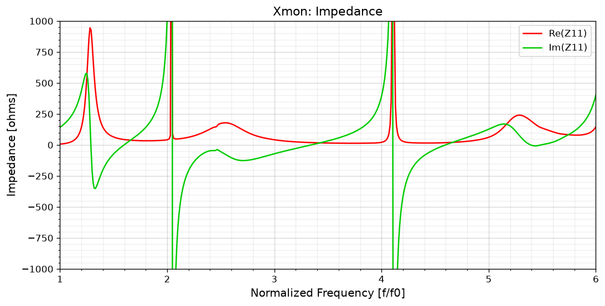
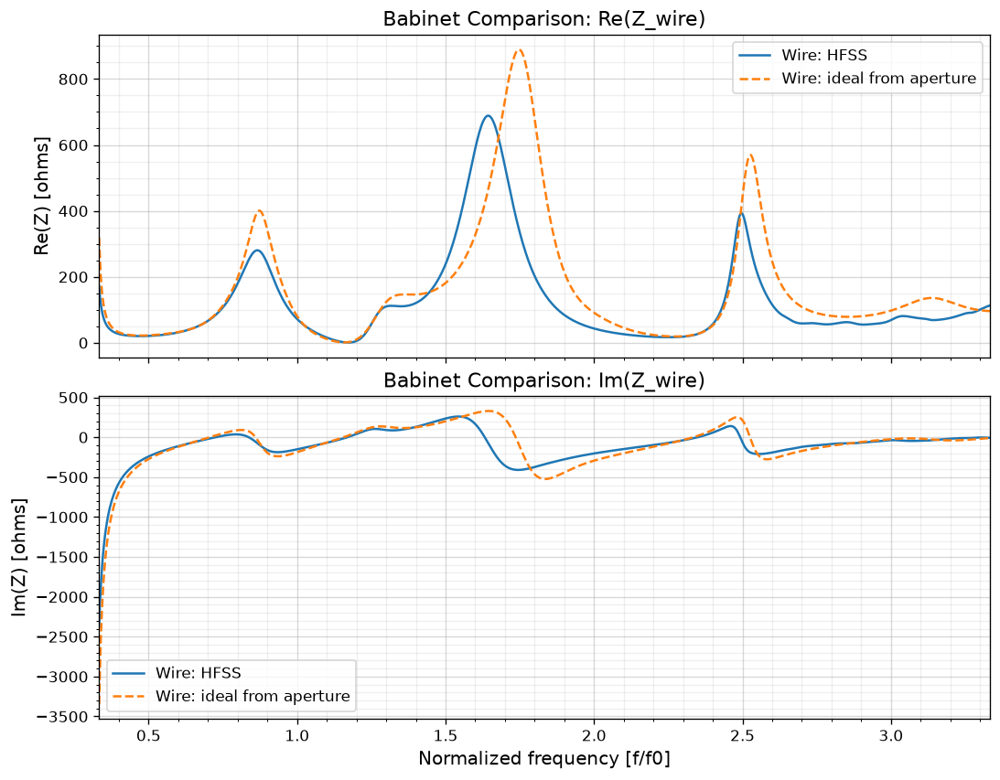
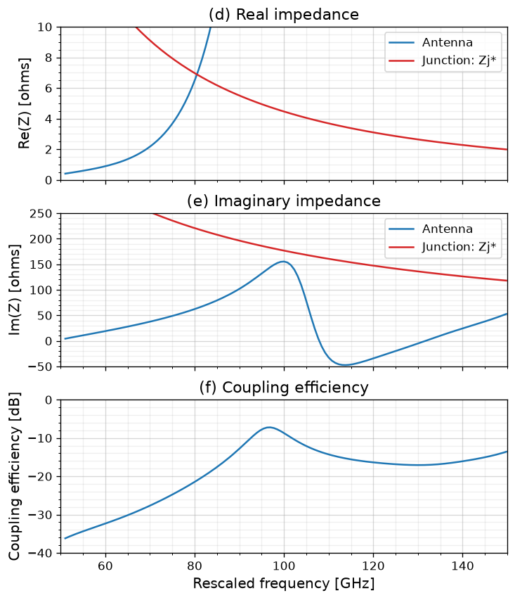

# Babinet Duality and Xmon Antenna Modes

HFSS simulations of dipole slots, loop slots, and Xmon antennas, with Python notebooks for impedance, Babinet duality, and junction coupling analysis.

## Files

| File | Purpose |
| --- | --- |
| [dipole_slot_plots.ipynb](dipole_slot_plots.ipynb) | Dipole-slot impedance and S11 plots. |
| [loop_slot_plots.ipynb](loop_slot_plots.ipynb) | Loop-slot plots and verification of S11 from impedance. |
| [xmon_plots.ipynb](xmon_plots.ipynb) | Xmon plots, wire/aperture comparison, junction coupling, and antenna noise bandwidth. |
| [plotting_hfss.py](plotting_hfss.py) | Shared `plot_hfss_curves()` plotting function. |
| [data/](data/) | HFSS CSV exports. |
| [hfss/](hfss/) | HFSS project files. |
| [figures/](figures/) | Exported Xmon figures. |

## Xmon Results

### Aperture impedance

Real and imaginary parts of the simulated Xmon aperture impedance.



### Babinet's theorem

For ideal complementary antennas with corresponding feeds and dual media [1],

$$
Z_{\mathrm{aperture}}Z_{\mathrm{wire}}=\frac{\eta_0^2}{4},
\qquad \eta_0\approx376.73\,\Omega.
$$

Simulated wire impedance compared with the prediction from aperture impedance:



### Junction coupling

Following [1], use $R_n=7\,\mathrm{k}\Omega$ and $C_j=9\,\mathrm{fF}$:

$$
Z_j=\frac{R_n}{1+j\omega R_nC_j},\qquad
e_c=1-\left|\frac{Z_{\mathrm{rad}}-Z_j^*}{Z_{\mathrm{rad}}+Z_j}\right|^2,
\qquad \Delta f_N=\int e_c(f)\,df.
$$

The vacuum simulation is rescaled using a size factor of 125 and the homogeneous-medium approximation $\epsilon_{\mathrm{eff}}=6$: $f_{\mathrm{target}}=125f_{\mathrm{sim}}/\sqrt6$ and $Z_{\mathrm{rad}}=Z_{\mathrm{sim}}/\sqrt6$.



## Run

```bash
pip install numpy scipy matplotlib jupyterlab
jupyter lab
```

Open a notebook from the project root and run all cells. CSV inputs are in `data/`.

## References

1. O. Rafferty et al., *Spurious Antenna Modes of the Transmon Qubit* (2021). [arXiv:2103.06803v2](https://arxiv.org/abs/2103.06803v2).
2. A. F. McKinley et al., *The analytical basis for the resonances and anti-resonances of loop antennas and meta-material ring resonators*, Journal of Applied Physics **112**, 094911 (2012). [doi:10.1063/1.4764104](https://doi.org/10.1063/1.4764104).
